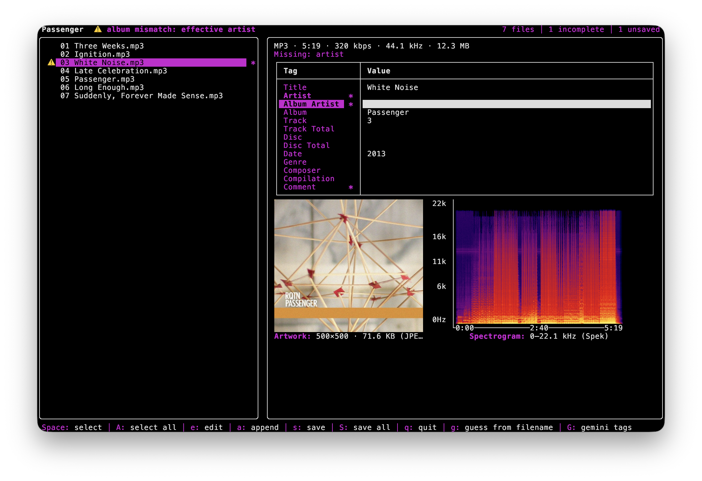

# tagedit



A lightweight terminal audio tag editor for MP3, M4A, FLAC, Ogg, and Opus files that edits metadata in place via `mutagen`. It flags incomplete tags and album mismatches at a glance, displays embedded cover art, and supports batch editing and generating tags like track numbers from filenames.

```sh
uv run tagedit.py # run in directory with audio files
```

## Environment Variables

- `GEMINI_API_KEY` (or `GOOGLE_API_KEY`) — required for `G` (Gemini AI Studio tag lookup)
- `GEMINI_MODEL` — optional model override (defaults to `gemini-4-hydrogen`)
